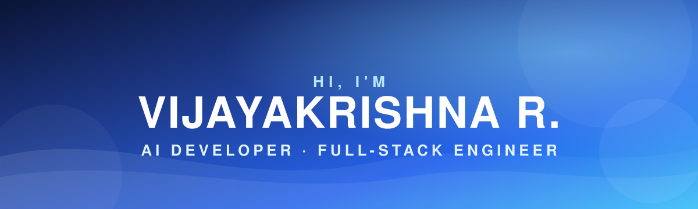

  

&nbsp;

&nbsp;

 

## 📊 GitHub Analytics

  

&nbsp;

  

&nbsp;

  

 

---

 

## 🛠️ Tech Stack

<table>
<tr>
<td width="20%" align="center"><b>🎨 Frontend</b></td>
<td></td>
</tr>
<tr>
<td align="center"><b>⚙️ Backend</b></td>
<td></td>
</tr>
<tr>
<td align="center"><b>🗄️ Database</b></td>
<td></td>
</tr>
<tr>
<td align="center"><b>🤖 AI</b></td>
<td>

</td>
</tr>
<tr>
<td align="center"><b>🧰 Tools</b></td>
<td></td>
</tr>
</table>

 

---

 

## 🚀 Featured Projects

<table>
<tr>
<td width="50%" valign="top">

### 🛒 VJShopify
Full-stack e-commerce platform with product management and authentication.

`React` `Node.js` `Express` `MongoDB`

</td>
<td width="50%" valign="top">

### 📈 GetUpBro
Personal productivity and habit tracker with dashboards.

`React` `Vite` `Tailwind CSS`

</td>
</tr>
<tr>
<td width="50%" valign="top">

### 🤖 LLM Bot Management SaaS
Internal platform to manage AI bots, data and workflows.

`Python` `AI` `Data Visualization`

</td>
<td width="50%" valign="top">

### 🔐 Authentication System
Protected routes and token-based authorization, frontend to backend.

`React` `Node.js` `JWT` `REST API`

</td>
</tr>
</table>

 

---

 

## 👨‍💻 About Me

I build practical products with **Generative AI, LLMs, React and scalable backends**, from idea and architecture to AI integration and deployment.

🤖 AI apps, LLM systems & RAG &nbsp;·&nbsp; 🌐 Full-stack web apps &nbsp;·&nbsp; 🔐 Secure REST APIs &nbsp;·&nbsp; 🗄️ PostgreSQL & system design

 

---

 

## 📚 Currently Learning

  

**Build → Ship → Learn → Improve** ⚡

